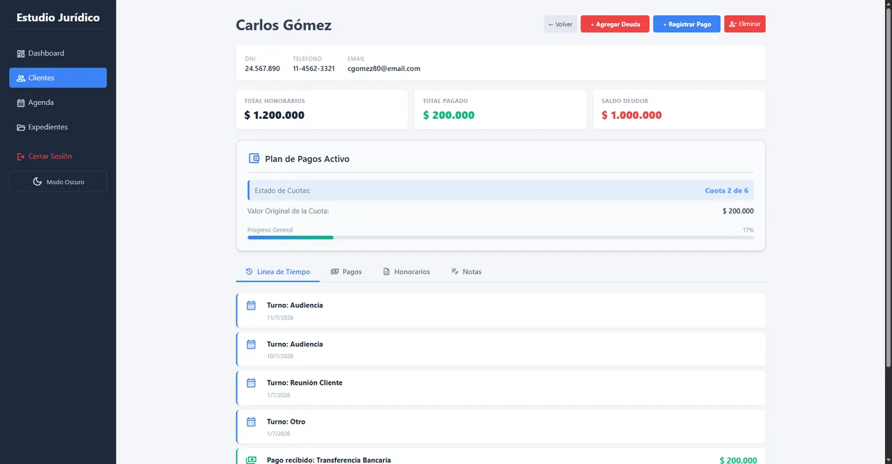
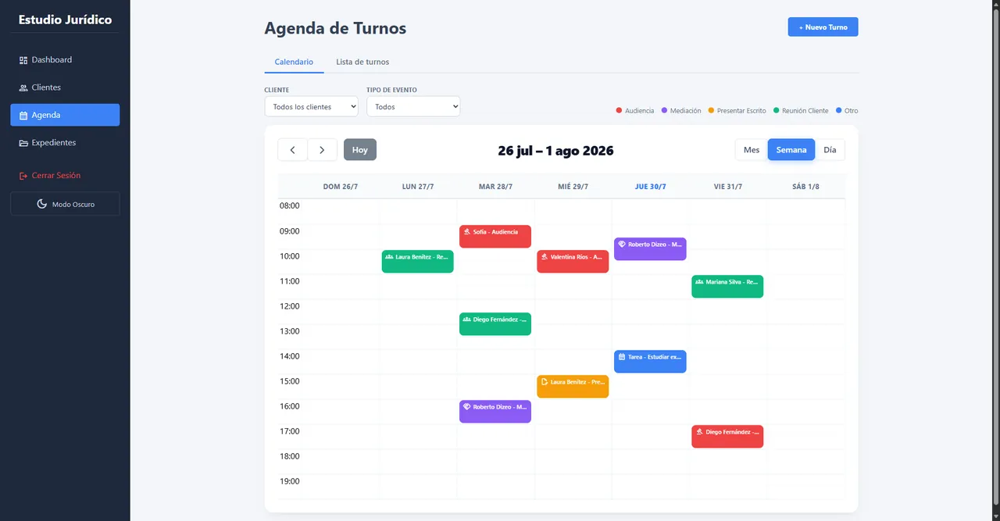
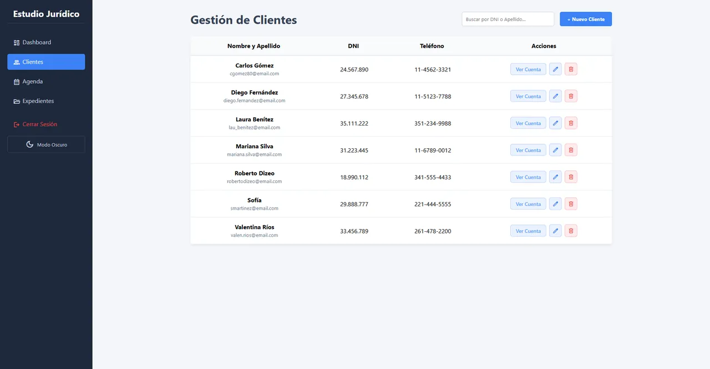
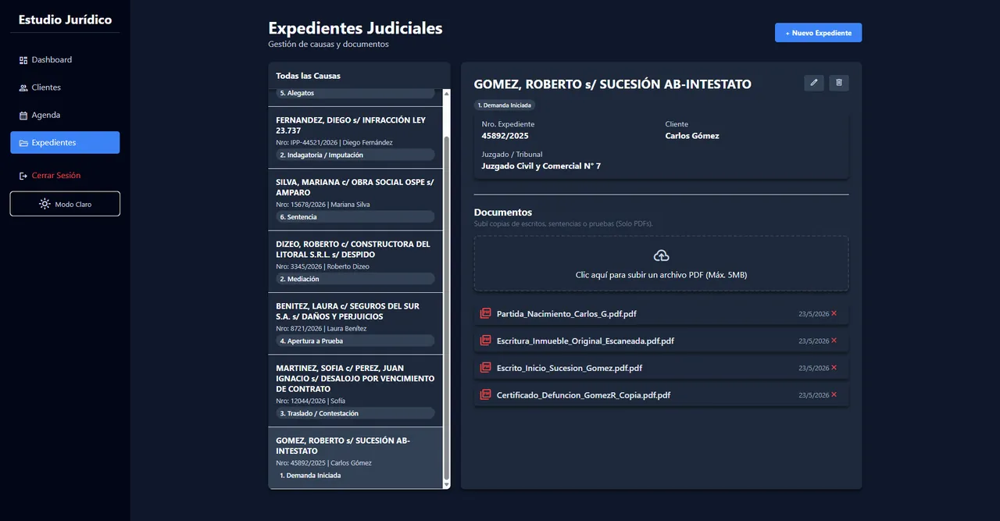

# ⚖️ Gestión de Estudio Jurídico

Sistema web para administrar un estudio jurídico: clientes, expedientes judiciales con sus PDFs, honorarios en cuotas, pagos y una agenda de audiencias con recordatorios por email.

**Está en uso por un estudio jurídico real.** Por eso no hay una demo pública: los datos son de clientes reales. El proyecto se puede levantar localmente con datos ficticios en unos minutos (ver [Cómo correrlo localmente](#cómo-correrlo-localmente)).


<table>
  <tr>
    <td width="72%"></td>
    <td></td>
  </tr>
  <tr>
    <td></td>
    <td></td>
  </tr>
</table>

<details>
<summary>Más capturas</summary>




</details>

Las capturas usan datos de demostración.

---

## Funcionalidades

- **Clientes**: alta, edición y baja (con todos sus datos en cascada), búsqueda sin importar acentos ni puntos del DNI y orden por columnas.
- **Cuenta corriente**: honorarios divididos en cuotas, pagos aplicados a un honorario, saldo deudor, cuota en curso y progreso del plan.
- **Expedientes judiciales**: carátula, juzgado, estado procesal y PDFs adjuntos, guardados en un bucket privado y abiertos con URLs firmadas.
- **Agenda**: vista mes, semana y día (FullCalendar), filtros por cliente y tipo de evento, estados (pendiente, completado, cancelado) y recordatorios por email configurables.
- **Dashboard**: clientes, turnos del día, ingresos del mes, notas rápidas y actividad reciente (log de auditoría).
- **PWA** instalable, diseño responsive y modo oscuro.

## Stack

| Capa            | Tecnologías                                                                 |
| --------------- | --------------------------------------------------------------------------- |
| Frontend        | HTML, CSS y JavaScript vanilla, FullCalendar, SweetAlert2, PWA              |
| Backend         | Node.js, Express 5, JWT, bcrypt, zod, helmet, express-rate-limit, node-cron |
| Datos           | PostgreSQL y Supabase Storage                                               |
| Calidad         | Jest, Supertest, PGlite, ESLint, Prettier, GitHub Actions                   |
| Infraestructura | Render (API), Vercel (frontend), Supabase (base y archivos)                 |

---

## Arquitectura

```
public/  (HTML + CSS + JS, PWA)
   │  fetch con JWT  (js/api.js)
   ▼
Express ─ src/app.js
   ├─ middlewares   helmet + CSP, CORS, rate limit, verificarToken (JWT),
   │                validar (zod) y manejo central de errores
   ├─ routes/       validan la entrada, llaman al modelo y arman la respuesta
   ├─ models/       consultas SQL parametrizadas (pg); transacciones donde hace falta
   └─ services/     Supabase Storage (URLs firmadas) y recordatorios por email
        │
        ├──► PostgreSQL (Supabase)
        └──► Supabase Storage (bucket privado "documentos")
```

```
├── server.js            Arranque: .env, conexión, cron de recordatorios y servidor HTTP
├── src/
│   ├── app.js           App de Express (middlewares y rutas), sin levantar el servidor
│   ├── config/          Base de datos, mailer y zona horaria del estudio
│   ├── middlewares/     Autenticación, validación y manejo de errores
│   ├── models/          Acceso a datos (una clase por tabla)
│   ├── routes/          Endpoints REST
│   ├── services/        Storage y recordatorios
│   └── validators/      Esquemas zod de lo que reciben las rutas
├── public/              Frontend
├── db/                  schema.sql, seed.sql y migrations/
├── scripts/             crear-usuario.js
└── tests/               Jest + Supertest
```

**Modelo de datos.** Todos los usuarios de una instalación comparten los clientes, expedientes, honorarios y pagos del estudio. La agenda, las notas rápidas y la actividad reciente son personales de cada usuario. El usuario siempre sale del JWT, nunca de la URL ni del body.

**Nombres heredados.** La tabla `expedientes` (y la ruta `/api/expedientes`) guarda los **honorarios** de un cliente, y `causas_judiciales` (`/api/causas`) son los **expedientes judiciales**. Los nombres vienen de la primera versión. Renombrarlos requiere una migración coordinada en producción y está pendiente.

El diagrama entidad-relación original está en [`docs/DER-Estudio-Juridico.png`](docs/DER-Estudio-Juridico.png). El esquema actual está en [`db/schema.sql`](db/schema.sql).

## Seguridad

- Contraseñas con bcrypt y sesiones con JWT (HS256, 8 horas).
- Rate limit en el login: 10 intentos fallidos por IP cada 15 minutos.
- Cada ruta que escribe valida su entrada con zod. Las consultas son parametrizadas.
- Los turnos y la actividad se filtran por el usuario del token, así que nadie puede ver ni modificar la agenda de otro.
- Todo dato dinámico se escapa antes de insertarlo en el HTML.
- helmet con Content Security Policy. CORS limitado a los orígenes configurados.
- Los PDFs están en un bucket privado. Se abren con una URL firmada que dura 60 segundos, se valida que el archivo sea realmente un PDF y, al borrar una causa o un cliente, se borran también sus archivos.
- RLS activado en todas las tablas: bloquea la API REST pública de Supabase. El backend se conecta directo a Postgres.

---

## Cómo correrlo localmente

**Requisitos:** Node.js 20 o superior y PostgreSQL 14 o superior (local, o un proyecto gratuito de Supabase).

```bash
git clone https://github.com/JuanEspinoza8/gestion-estudio-juridico.git
cd gestion-estudio-juridico
npm install
```

**1. Crear la base con datos de demostración**

Con un Postgres local:

```bash
createdb estudio
psql -d estudio -f db/schema.sql
psql -d estudio -f db/seed.sql
```

Con Supabase: pegá `db/schema.sql` y después `db/seed.sql` en el SQL Editor de un proyecto **nuevo**.

> `db/seed.sql` crea un usuario con contraseña conocida: es solo para desarrollo, nunca para una base real.

**2. Configurar el entorno**

```bash
cp .env.example .env
```

Para un Postgres local alcanza con completar:

```env
JWT_SECRET=cualquier-texto-largo-y-aleatorio
DB_HOST=localhost
DB_USER=postgres
DB_PASSWORD=tu-contraseña
DB_NAME=estudio
DB_SSL=false
```

**3. Levantar el servidor**

```bash
npm run dev
```

Abrí http://localhost:3000/login.html y entrá con **demo@estudio.test / demo1234**. Express sirve también el frontend, y `public/js/config.js` apunta solo al backend local cuando la página se abre desde `localhost`.

Para subir PDFs hace falta Supabase Storage: un bucket privado llamado `documentos` y las variables `SUPABASE_URL` y `SUPABASE_SERVICE_KEY`. Sin ellas, todo lo demás funciona y la subida responde que el almacenamiento no está configurado.

**Crear usuarios.** No hay registro público. Para crear un usuario (la contraseña se pide por consola y se guarda hasheada):

```bash
npm run crear-usuario -- "Nombre Apellido" email@estudio.com
```

### Variables de entorno

| Variable               | Para qué                                                                                   |
| ---------------------- | ------------------------------------------------------------------------------------------ |
| `PORT`                 | Puerto del servidor (3000 por defecto)                                                     |
| `JWT_SECRET`           | Secreto para firmar los JWT. **Obligatoria**                                               |
| `CORS_ORIGINS`         | Orígenes del frontend que pueden usar la API, separados por coma                           |
| `DB_HOST` … `DB_NAME`  | Conexión a PostgreSQL                                                                      |
| `DB_SSL` / `DB_SSL_CA` | `false` para un Postgres local / certificado CA de Supabase para verificar la conexión SSL |
| `SUPABASE_URL`         | URL del proyecto de Supabase (Storage)                                                     |
| `SUPABASE_SERVICE_KEY` | Clave `service_role` de Supabase. Solo en el backend                                       |
| `SMTP_*`, `MAIL_FROM`  | Envío de recordatorios por email. Opcionales: sin ellas, los recordatorios se desactivan   |
| `CRON_SECRET`          | Protege `/api/cron/recordatorios`                                                          |

El detalle de cada una está en [`.env.example`](.env.example).

## Tests y calidad

```bash
npm test          # Jest + Supertest
npm run lint      # ESLint
npm run format    # Prettier
```

Los tests cubren autenticación (login, token vencido o falsificado, rate limit), aislamiento entre usuarios, validación de pagos y del resto de las rutas, cálculo de saldos, documentos con URLs firmadas, CORS y headers de seguridad. [`tests/integracion.test.js`](tests/integracion.test.js) carga `schema.sql` y `seed.sql` en un PostgreSQL en memoria ([PGlite](https://pglite.dev)) y prueba la API con el SQL real, así el esquema, el seed y las consultas no se desincronizan.

GitHub Actions corre lint, formato y tests en cada push a `main` y en cada pull request.

## Deploy

- **API**: Render, con deploy automático desde `main`.
- **Frontend**: Vercel, que sirve `public/`.
- **Base y archivos**: Supabase (PostgreSQL + Storage).
- **Recordatorios**: un cron interno (`node-cron`) cada 5 minutos. Como Render free duerme el servicio, un monitor externo (UptimeRobot) llama a `/api/cron/recordatorios?secret=…`.
- **Cambios de esquema**: los scripts de `db/migrations/` se corren a mano en Supabase **antes** de desplegar el código que los necesita. Son aditivos, así que la versión anterior sigue funcionando mientras tanto.

## Limitaciones conocidas

- El JWT se guarda en `localStorage`. Lo mitigan el escape de HTML y la CSP, pero lo ideal sería una cookie `httpOnly`.
- El `rol` viaja en el JWT pero no se verifica: todos los usuarios tienen los mismos permisos, incluido borrar clientes con todos sus datos.
- El HTML usa atributos `onclick="..."`, lo que obliga a permitir `script-src-attr 'unsafe-inline'` en la CSP. Además, la CSP solo se aplica cuando Express sirve el frontend: Vercel todavía no envía esos headers.
- Una instalación atiende a un solo estudio (no es multi-tenant).
- Los nombres de las tablas `expedientes` y `causas_judiciales` son confusos (ver arriba).
- El saldo y la cuota en curso se calculan sobre el total de honorarios del cliente, no por cada honorario.
- El rate limit guarda los intentos en memoria: alcanza para una sola instancia.
- El frontend no tiene build, tests automatizados ni formato con Prettier (está pendiente para no generar conflictos con cambios en curso).
- `db/schema.sql` se reconstruyó a partir del código y del DER: puede diferir en detalles de la base de producción.

---

## Trabajo en equipo

Lo desarrollamos entre dos personas con un flujo de trabajo de equipo:

- Tablero Kanban con **user stories** numeradas (por ejemplo `US2.4 – Implementación SQL en métodos POO`, `US3.1 – Login y JWT`) organizadas en sprints.
- Una rama por historia o arreglo (`feature/us…`, `fix/…`, `sprint-N-…`) y un **pull request** para integrar cada cambio a `main` (37 mergeados hasta ahora, de los dos).
- Commits con [Conventional Commits](https://www.conventionalcommits.org/es/) en español.

<table>
  <tr>
    <td align="center">
      <a href="https://github.com/JuanEspinoza8">
        <br />
        <b>Juan Espinoza</b>
      </a>
      <br />
      Lead Developer
    </td>
    <td align="center">
      <a href="https://github.com/Lucas-04git">
        <br />
        <b>Lucas</b>
      </a>
      <br />
      Frontend & UI/UX Developer
    </td>
  </tr>
</table>

## Licencia

[MIT](LICENSE)
